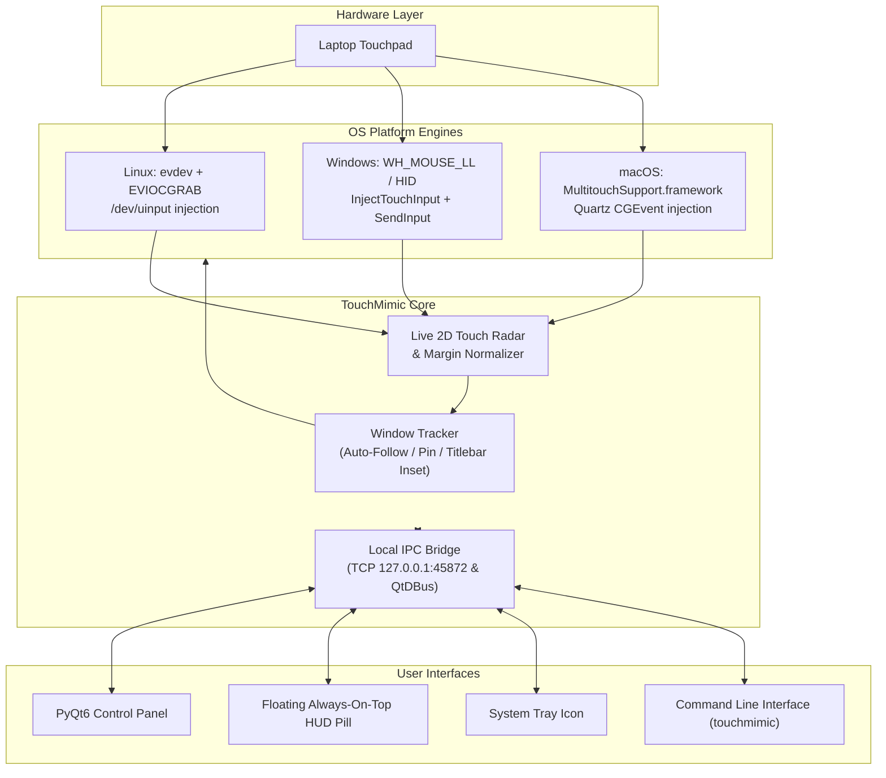

# TouchMimic

<p align="center">
  <strong>Turn your laptop touchpad into an on-demand, 1:1 absolute touchscreen mapped directly to your active window, pinned mobile app, or full display.</strong>
</p>

<p align="center">
  
  
  
  
  
</p>

---

## 📖 Overview

Using a standard mouse or touchpad to interact with vertical feeds (TikTok, Instagram Reels, YouTube Shorts) and mobile environments (Android Studio AVD, Waydroid, BlueStacks, Scrcpy) feels awkward. Traditional laptop touchpads operate in **relative cursor mode**, requiring repetitive flicking and dragging to scroll.

**TouchMimic** bridges this gap by transforming your laptop touchpad into an **on-demand 1:1 absolute touchscreen**. Touching any physical point on your touchpad instantly taps or drags at the exact proportional point inside your target window, and lifting your finger immediately releases. 

When you need standard cursor navigation, toggle TouchMimic off with an effortless gesture or hotkey — no driver reboots or physical device reconfiguration required.

```
       LAPTOP TOUCHPAD (Absolute Contact)                     TARGET WINDOW (1:1 Proportional)
┌──────────────────────────────────────────────┐        ┌─────────────────────────────────────────┐
│  [Touch Top-Left]                            │        │ [Window Titlebar Skipped]               │
│         • (0.2, 0.2)                         │        │   • Direct Tap / Drag at (20%, 20%)     │
│                                              │        │                                         │
│                      [Swipe Down]            │  ───►  │                       │                 │
│                           │                  │        │                       ▼ 1:1 Drag Feed   │
│                           ▼                  │        │                                         │
│                                              │        │                                         │
└──────────────────────────────────────────────┘        └─────────────────────────────────────────┘
```

---

## ✨ Features

- **🎯 True 1:1 Absolute Mapping**
  - Physical coordinates on the touchpad map proportionally to the bounds of the target application.
  - Tapping down initiates a touch contact; moving drags smoothly; lifting releases instantly.
- **🪟 Smart Window Tracking**
  - **Auto-Follow Mode**: Dynamically follows the active focused window as you switch tasks.
  - **Pinned Window Mode**: Locks the mapping to a chosen application (e.g., TikTok or an Android Emulator) even when other windows are in view.
  - **Crosshair Picker**: Click and target any running desktop window interactively.
  - **Titlebar Avoidance (Top Inset)**: Configurable margin (default 32px) so touching the top edge of your touchpad never accidentally hits close, minimize, or drag handles.
  - **Touchpad Edge Margin**: Adjustable boundary deadzone (0–15%) for comfortable finger ergonomics.
- **⚡ Instant On-Command Activation**
  - **3-Finger Tap**: Tap three fingers simultaneously on the touchpad to flip between standard touchpad and touchscreen mode.
  - **Global Hotkeys**: Quick-toggle anywhere via `F8` or `Ctrl + Alt + T`.
  - **Floating HUD Pill**: An always-on-top, draggable status pill with one-click toggle and pin controls.
  - **System Tray**: Live status indicator icon and context menu.
  - **Scriptable CLI / IPC**: Query status, toggle, pin, or switch modes from the command line or custom scripts.
- **🕹️ Dual Emulation Modes**
  - **Universal 1:1 Touch-Drag Click**: Absolute cursor move + left-down/up drag emulation. Provides universal compatibility across all apps, emulators, and browsers.
  - **Native Kernel Multi-Touch**: Injects genuine operating system multi-touch packets for pinch-to-zoom and multi-finger gestures.
- **📊 Real-Time Touchpad Radar**
  - Live 2D visualization of physical finger position, contact state, and active deadzones directly inside the control panel.

---

## 🏗️ Multi-Platform Architecture

TouchMimic is written in pure Python with zero third-party C-extensions, using native OS bindings (`ctypes`, DBus, and Win32):

| Platform | Touch Capture Backend | Touch Injection Backend | Window Geometry Tracking |
| :--- | :--- | :--- | :--- |
| **Linux (Wayland & X11)** | Raw `evdev` multi-touch slot parser (`/dev/input/event*`) with `EVIOCGRAB` | Kernel `/dev/uinput` (`TouchMimic Virtual Touchscreen` & `Absolute Pointer`) | KDE KWin DBus Scripting API & `_NET_ACTIVE_WINDOW` |
| **Windows (10 / 11)** | Low-level Win32 hooks (`WH_MOUSE_LL`, `WH_KEYBOARD_LL`) & HID digitizer listener | `user32.dll` `InjectTouchInput` + `SendInput` virtual desktop mapping | Win32 `GetForegroundWindow` & `GetWindowRect` |
| **macOS** | Apple `MultitouchSupport.framework` (`MTRegisterContactFrameCallback`) | Quartz CoreGraphics `CGEvent` touch-drag stream | Quartz Window Services & AppleScript / System Events |



---

## 📦 Standalone Binaries (Windows, Linux, macOS)

If you do not want to install Python or PyQt6, standalone pre-compiled executable packages are available:

- **🪟 Windows**: `TouchMimic-Windows-x64.zip` (contains standalone `TouchMimic.exe`)
- **🐧 Linux**: `TouchMimic-Linux-x86_64.tar.gz` (contains standalone `TouchMimic` ELF binary + `setup-permissions.sh`)
- **🍎 macOS**: `TouchMimic-macOS-Universal.zip` (contains `TouchMimic.app` application bundle)

You can download the latest builds from the **[Releases](https://github.com/silayobosco/touchpad-touchscreen-mimic/releases)** page or **GitHub Actions** build artifacts.

### 🔨 Building Standalone Binaries Locally

A unified build script [`build_standalone.py`](build_standalone.py) is included to generate standalone binaries for your current operating system with PyInstaller:

```bash
# 1. Install build requirements
pip install pyinstaller PyQt6

# 2. Build the binary for your platform:
python build_standalone.py

# Optional: Build with visible terminal console for CLI debugging
python build_standalone.py --console
```

The output will be placed in the `dist/` directory:
- **Windows**: `dist/TouchMimic.exe`
- **Linux**: `dist/TouchMimic`
- **macOS**: `dist/TouchMimic.app`

---

## 🚀 Installation (From Source)

### Requirements
- **Python**: `>= 3.9`
- **Dependencies**: `PyQt6 >= 6.4.0`

### 1. Clone & Install
```bash
git clone https://github.com/silayobosco/touchpad-touchscreen-mimic.git
cd touchpad-touchscreen-mimic

# Option A: Editable pip installation (recommends virtualenv)
pip install -e .

# Option B: Install requirements directly
pip install -r requirements.txt
```

### 2. Quick Launcher Scripts
You can also run TouchMimic directly without installing into your global PATH:
- **Linux / macOS**: `./bin/touchmimic`
- **Windows**: `bin\touchmimic.bat`

---

## 🔑 Permissions Setup (One-Time)

Depending on your operating system, capturing low-level hardware events or injecting input requires permissions:

### 🐧 Linux (Wayland / X11)
Non-root users require read/write access to `/dev/uinput` and `/dev/input/event*`:
- **Via GUI**: Click **"🔑 Grant Input Permissions"** on the warning banner inside the TouchMimic panel.
- **Via Terminal**:
  ```bash
  touchmimic permissions
  # or run the included shell script:
  ./setup-permissions.sh
  ```
  *This configures a persistent udev rule (`/etc/udev/rules.d/99-touchmimic.rules`) and grants immediate access via `setfacl` — no system reboot needed.*

### 🪟 Windows (10 / 11)
- **No extra drivers or permissions required.** TouchMimic uses standard Win32 Touch Injection APIs (`InitializeTouchInjection` and `InjectTouchInput`) available on Windows 8, 10, and 11 out of the box.

### 🍎 macOS
- macOS requires **Accessibility** permission to emit synthetic Quartz CGEvents.
- When prompted, allow TouchMimic in **System Settings → Privacy & Security → Accessibility**, or trigger the prompt via:
  ```bash
  touchmimic permissions
  ```

---

## 💻 Usage Guide

### Starting the Application

```bash
# Launch the main Control Panel and Floating HUD
touchmimic

# Launch directly into touchscreen mode
touchmimic gui --active

# Start minimized to the floating HUD pill only (daemon mode)
touchmimic gui --hud-only
```

### Controlling Touch Mode

| Trigger | Description |
| :--- | :--- |
| **3-Finger Tap** | Tap three fingers on your touchpad to toggle Touch Mode on or off instantly. |
| **`F8` Key** | Global hotkey to toggle Touch Mode from any application. |
| **`Ctrl + Alt + T`** | Alternative global hotkey. |
| **Floating HUD** | Click the **"Toggle (F8)"** button on the floating pill. |
| **System Tray** | Click the tray icon or right-click to toggle/pin. |
| **CLI / IPC** | Run `touchmimic toggle` from any terminal or hotkey manager. |

---

## ⌨️ CLI Reference & Scripting

TouchMimic includes a full CLI client that communicates with the active background instance over local IPC (TCP port `45872` / DBus):

```bash
# Toggle Touch Mode ON/OFF
touchmimic toggle

# Force enable Touch Mode (auto-starts background daemon if not already running)
touchmimic on

# Disable Touch Mode (return touchpad to normal cursor operation)
touchmimic off

# Pin / unpin the current foreground window as the touch target
touchmimic pin

# Print running status, current target window, and hardware diagnostics
touchmimic status

# Grant platform input permissions (udev on Linux, Accessibility on macOS)
touchmimic permissions
```

#### Example CLI Status Output:
```text
Platform       : linux
Status         : 🟢 ACTIVE (Touchscreen Mode)
Touchpad       : SynPS/2 Synaptics TouchPad (/dev/input/event5)
Emulation Mode : pointer_drag
Target Mode    : active_window
Target Window  : Waydroid (600x1024 @ 660,180)
```

---

## 🛠️ Configuration & Settings

Inside the **TouchMimic Control Panel**, you can fine-tune:

1. **Mapping Target**:
   - `🎯 Active Focused Window`: Automatically updates the target coordinates whenever you switch windows.
   - `📌 Pinned / Locked Window`: Locks touch coordinates to a specific application window regardless of focus.
   - `🖥️ Entire Screen`: Uses your full monitor resolution as the absolute surface.
2. **Window Titlebar Skip (Top Inset)**:
   - Configurable vertical pixel inset (0–150 px, default `32px`). Ensures touching the top of your touchpad interacts with the app content rather than dragging or closing the window frame.
3. **Touchpad Edge Margin**:
   - Margin deadzone (0–15%, default `3%`) along the perimeter of the touchpad so you can comfortably reach the edges of the window without slipping off the hardware.
4. **Touch Emulation Engine**:
   - `👆 Universal 1:1 Touch-Drag Click`: Smooth single-touch absolute tracking with instant drag.
   - `📱 Native Kernel Multi-Touch`: Multi-touch slot injection for multi-finger pinch/zoom.

---

## 🎯 Popular Use Cases

- **📱 Mobile App Scrolling (TikTok, Reels, Shorts)**: Swipe feeds smoothly with 1:1 physical finger distance just like a phone.
- **🤖 Android Emulators**: Effortless navigation in Android Studio AVD, Waydroid, BlueStacks, LDPlayer, and Scrcpy.
- **🎨 Quick Signatures & Drawing**: Sign documents or sketch directly within document viewers and web forms using absolute coordinates.
- **🌐 Responsive Web Testing**: Test mobile layouts, touch carousels, and drawer navigations directly in your browser's DevTools touch simulator.

---

## 📁 Project Structure

```text
touchpad-touchscreen-mimic/
├── bin/
│   ├── touchmimic              # Linux/macOS executable runner
│   └── touchmimic.bat          # Windows batch launcher
├── touchmimic/
│   ├── __init__.py             # Package metadata
│   ├── __main__.py             # Module execution entrypoint
│   ├── cli.py                  # CLI argument parser & IPC client
│   ├── gui.py                  # PyQt6 Control Panel, Radar & HUD Pill
│   ├── platform_backend.py     # Cross-platform engine factory & local IPC socket
│   ├── linux_input.py          # Linux evdev reader & uinput virtual emitter
│   ├── windows_input.py        # Windows Win32 hooks & InjectTouchInput emitter
│   ├── macos_input.py          # macOS MultitouchSupport & Quartz CGEvent emitter
│   └── window_tracker.py       # Active window geometry tracker (KWin/Win32/Quartz)
├── setup-permissions.sh        # Linux udev & ACL setup script
├── pyproject.toml              # Build & dependency specifications
├── requirements.txt            # Python requirements
├── LICENSE                     # MIT License
└── README.md                   # Project documentation
```

---

## ❓ Troubleshooting & FAQ

<details>
<summary><strong>Linux: Touchpad stops responding or permission denied</strong></summary>

TouchMimic requires read access to `/dev/input/event*` and write access to `/dev/uinput`. Run:
```bash
touchmimic permissions
```
Or execute `./setup-permissions.sh`. This grants current-session ACL permissions via `setfacl` and configures a permanent udev rule.
</details>

<details>
<summary><strong>Linux Wayland: Target window size is not updating</strong></summary>

On KDE Plasma Wayland, TouchMimic uses KWin's DBus scripting interface. Ensure DBus is enabled. If running on GNOME or another Wayland compositor, you can use the **📌 Pin Window** or **🖥️ Entire Screen** mode.
</details>

<details>
<summary><strong>Windows: Touches are offset on high-DPI displays</strong></summary>

TouchMimic automatically accounts for DPI scaling via `user32.GetDpiForWindow` / `GetSystemMetrics(SM_CXVIRTUALSCREEN)`. If an emulator has custom DPI virtualization, set Touch Target to **📌 Pinned Window** or adjust the Window Titlebar Inset.
</details>

<details>
<summary><strong>How do I exit Touch Mode if my touchpad is locked?</strong></summary>

Press **`F8`** or **`Ctrl + Alt + T`** on your physical keyboard at any time. You can also run `touchmimic off` from a terminal or terminal shortcut.
</details>

---

## 📄 License

This project is licensed under the [MIT License](LICENSE).
